# 11ty Demos

**Live: [11ty-demos.netlify.app](https://11ty-demos.netlify.app/)**

A single Eleventy site that hosts many independent Eleventy implementation patterns as standalone demo pages — instead of one repo per pattern. Every demo is real and wired into the site itself: the _Dark Mode_ demo is the site's actual theme toggle, the _Search_ demo is the header search bar, and so on.

## Quick start

Requires Node 24 (see `.nvmrc`; `nvm use` picks it up).

```bash
npm install
npm start            # dev server at http://localhost:3000
npm run build        # eleventy build (JS bundled by esbuild) + pagefind indexing, output to public/
npm test             # unit tests: filters, build helpers, the view-counter function
npm run test:smoke   # checks the built public/ folder: links, ids, sitemap, feed, asset versions, CSP
npm run lint         # ESLint over all JS, including tests and netlify/
npm run format       # Prettier --write over js/scss/json/md (not .njk — see prettier.config.js)
npm run check        # everything CI runs: lint, format check, tests, build, smoke tests
```

Optional: copy `.env.example` to `.env` and add a free `PEXELS_API_KEY` to get real photos in the gallery demos. Without it they use local placeholder images and log one warning.

## Architecture

```mermaid
graph TD
    Config["eleventy.config.js<br/><i>thin orchestrator</i>"] --> Src["src/"]
    Config --> Netlify["netlify/functions/views.js → netlify/lib/view-counter.js<br/><i>backs the View Counter demo</i>"]
    Config --> Hooks["eleventy.before / eleventy.after<br/><i>esbuild bundle (scripts.js), CSP _headers (csp.js)</i>"]

    Src --> Eleventy11ty["_11ty/"]
    Eleventy11ty --> Glob["registerFromGlob.js<br/><i>scans a folder, registers each file by filename</i>"]
    Eleventy11ty --> Filters["filters/<br/><i>readableDate.js, toc.js, ...</i>"]
    Eleventy11ty --> Shortcodes["shortcodes/<br/><i>codeFile.js, image.js</i>"]
    Eleventy11ty --> Collections["collections/<br/><i>demos.js, demoTags.js, posts.js</i>"]
    Eleventy11ty --> Transforms["transforms/<br/><i>htmlmin.js</i>"]
    Eleventy11ty --> Sass["sass.js<br/><i>Sass via Eleventy's addExtension API</i>"]

    Src --> Data["_data/"]
    Data --> Site["site.js<br/><i>sitewide metadata</i>"]
    Data --> DemoData["lighthouse.js, multiFormatImageDemo.js,<br/>responsiveImageDemo.js<br/><i>precomputed data for specific demos</i>"]

    Src --> Includes["_includes/"]
    Includes --> Layouts["layouts/<br/><i>base → page / demo / blog-post</i>"]
    Includes --> Components["components/<br/><i>header, footer, nav, theme-toggle, search-bar,<br/>demo-card, tag-list, difficulty-badge, breadcrumbs, pagination-nav</i>"]
    Includes --> DemoLive["demo-live/<br/><i>one real partial per demo's Live Implementation</i>"]

    Src --> Demos["demos/"]
    Demos --> DemosJson["demos.json<br/><i>layout, base tag, permalink</i>"]
    Demos --> DemosMd["*.md — one demo per file"]

    Src --> Blog["blog/"]
    Blog --> BlogJson["blog.json<br/><i>same pattern as demos.json</i>"]
    Blog --> BlogMd["*.md"]

    Src --> Assets["assets/"]
    Assets --> Scss["scss/<br/><i>abstracts / base / layout / components / pages</i>"]
    Assets --> Js["js/<br/><i>main.js imports the rest; esbuild bundles it into one versioned file — no framework</i>"]
    Assets --> Images["images/demos/<br/><i>one thumbnail SVG per demo</i>"]

    Src --> TopLevel["index.njk, about.md, demos.njk, tags.njk,<br/>blog.njk, feed.njk, search-index.njk"]
```



## Adding a new demo

Drop a Markdown file into `src/demos/`:

```yaml
---
title: "Your Demo Title"
description: "One sentence describing what this demo actually does."
tags: ["some-tag", "another-tag"]
date: 2026-08-01
difficulty: "Intermediate"   # Beginner | Intermediate | Advanced
thumbnail: /assets/images/demos/your-demo-title.svg
order: 90                     # optional; controls listing/prev-next order
demoBlock: "demo-live/your-demo-title.njk"   # optional; a real, working live example
draft: true                   # optional; keeps it off the live site until removed
---

## How It Works
...
## Folder Structure
...
## Important Files

## Notes
...
```

That's the entire contract. The new demo automatically:

- Gets the shared hero/layout (`src/demos/demos.json` sets the default `layout` and computed permalink `/demos/<slug>/`).
- Appears on `/demos/` (the listing loops the `demos` collection).
- Gets a `/demos/tags/<tag>/` page for each of its tags.
- Is included in `/search-index.json` → the header search.
- Slots into Previous/Next navigation, ordered by `order` (or title).
- Gets "Source on GitHub" links and, once committed, a last-updated date from git.
- Is checked by the build smoke tests (links, ids, sitemap, search index).
- Can show up in other demos' "Related Demos" sections via shared tags.

No other file needs to change.

The same "just add a file" idea applies to the build config itself: a new filter, shortcode, or collection is a single default-exported function under `src/_11ty/filters/`, `src/_11ty/shortcodes/`, or `src/_11ty/collections/` — `registerFromGlob` picks it up by filename, nothing to register in `eleventy.config.js`.

## What's built

Dark Mode, Multi-level Navigation, Tags, Syntax Highlighting, Table of Contents, Search, RSS, Breadcrumbs, Pagination, Collections, Contact Form, Responsive Images, Pagefind Search, Multi-format Images, Live Lighthouse Scores, Reading Time, Live View Counter, Image Gallery, Masonry Gallery, Data Files, Custom Filters, Shortcodes, Print Stylesheet, Copy Code Button, Accessibility, Sitemap, 404 Page, Schema.org / JSON-LD, Unit Tests, Cache Busting, CSS and Web Font Toggles, Draft Posts, Scheduled Rebuilds, Generated Social Images, Resume Reading, Back to Top, Smooth Page Transitions, Instant Navigation, Automatic Image Optimization, Image Lightbox — plus the whole architecture (collections, listing with tag/difficulty filters, tag pages, search, prev/next, SCSS system, blog scaffold). Every demo page links to its own source on GitHub and shows when it was last changed, taken from git history, and every page gets its own generated 1200×630 social card.

That covers the original list and everything added since. Anything new is an addition, not a gap — the recipe under "Adding a new demo" above is still all that's needed.

## Testing and CI

- `npm test` runs the unit tests in `test/*.test.js` with Node's built-in test runner. The Unit Tests demo runs the same suite during the build and shows the live result.
- `npm run test:smoke` runs `test/smoke/` against the built `public/` folder, so run `npm run build` first. It fails on broken internal links or `#fragments`, duplicate ids, a sitemap or feed that doesn't match what was built, unversioned CSS/JS, or an inline script the CSP doesn't allow.
- GitHub Actions:
    - **CI** (`ci.yml`), on every push and pull request to `main`/`master`: lint, format check, unit tests, build, smoke tests, plus a separate `npm audit --audit-level=high` job.
    - **Lighthouse CI** (`lighthouse-ci.yml`), on pull requests: builds the site and audits five pages against `lighthouserc.json`.
    - **Update Lighthouse Scores** (`update-lighthouse-scores.yml`), weekly: fetches PageSpeed scores for the live site and commits `src/_data/lighthouseScores.json` if they changed. Commits pushed with the workflow's own token don't trigger other workflows, so this never loops; Netlify still redeploys from the commit. It needs a `PAGESPEED_API_KEY` repository secret.
    - **Scheduled Netlify Rebuild** (`scheduled-rebuild.yml`), daily at 01:30 UTC: POSTs to a Netlify build hook so build-time data (Lighthouse scores, Pexels photos, updated dates, test results) stays fresh without a push. It needs a `NETLIFY_BUILD_HOOK_URL` repository secret; without one it logs a warning and succeeds, so it never sends failure emails.
- Dependabot (`.github/dependabot.yml`) opens grouped dependency updates weekly and GitHub Actions updates monthly.

## Deployment

Configured for Netlify (`netlify.toml`: `npm run build`, publish `public`, Node 24). No `pathPrefix` is set since Netlify serves from the domain root.

- **Caching:** `main.css` and `main.js` are always linked as `?v=<content hash>` (the `assetUrl` filter), so `/assets/js/*`, `/assets/scss/*`, and the content-hashed `/assets/images/optimized/*` are cached for a year as `immutable`. Demo thumbnails are cached for a day; everything else, including HTML, revalidates on every request.
- **Security headers:** `netlify.toml` sets `X-Content-Type-Options`, `Referrer-Policy`, `X-Frame-Options: DENY`, and `Permissions-Policy` on every path. The build also writes `public/_headers` with a `Content-Security-Policy-Report-Only` header whose `script-src` lists the hash of every inline script in the built HTML, so it can never drift from the real markup. It's report-only for now: check the browser console on a deploy preview for violations before switching the header name to `Content-Security-Policy`.
- **Drafts:** front matter `draft: true` keeps a page out of production builds. `npm start` includes drafts, and `netlify.toml` sets `INCLUDE_DRAFTS=true` for deploy previews so drafts can be reviewed at a real URL; draft pages get a banner and `noindex`.
- **Environment variables:** `PEXELS_API_KEY` (optional, build time) for the gallery demos. `INCLUDE_DRAFTS` (`"true"` to build drafts; already set for deploy previews). The view counter needs nothing; Netlify Blobs is available to every Netlify site.
